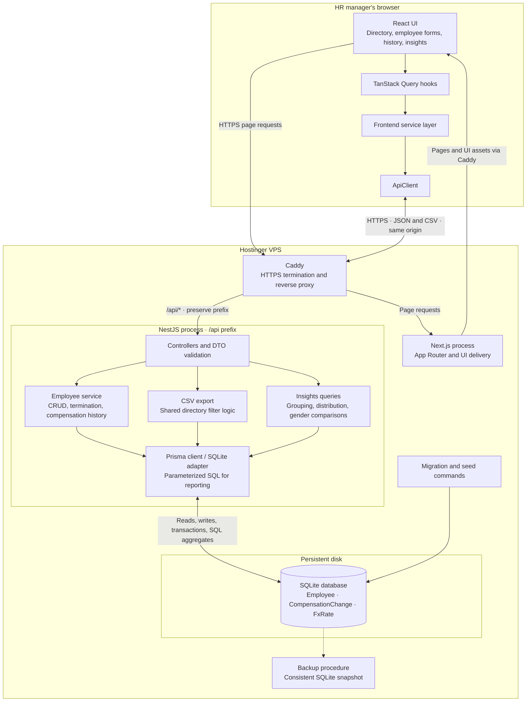

# Application architecture

Planned deployment: one Hostinger VPS, with **Caddy** as the reverse proxy and SQLite on persistent disk. This describes the intended system, not an already verified deployment.

- Caddy serves one public origin, routing `/api/*` to NestJS without stripping its global prefix and other application requests to Next.js. The browser uses that origin for API requests.
- Only NestJS accesses employee data during normal application use. Next.js does not connect to the database.
- Pagination, search, filtering, FX conversion for reports, and aggregations run on the server/database. The browser receives page-sized records or reporting results.
- Compensation updates and history inserts share a transaction. Export reuses directory filtering rules so downloaded records match the selected filters.
- The logical service boxes describe responsibilities within one backend, not separate deployed services. No authentication, external FX service, cache service, or background job service is in scope.
- Server unit tests cover isolated business rules; SQLite integration tests cover queries, persistence, and transaction behavior. UI verification is manual for now.
- Production process management, backup scheduling/destination, and restore verification are deployment tasks tracked in [the plan](PLAN.md#9-release-and-submission).
