# Application architecture

Current deployment: [incubyte.ruv.world](https://incubyte.ruv.world) serves the Next.js app and [api.incubyte.ruv.world](https://api.incubyte.ruv.world/api/health) serves the NestJS API. The project owner confirmed **Caddy** on the VPS with **PM2** managing the application processes. Both public hosts and the production API were checked on 2026-10-24.

- Caddy proxies the frontend hostname to Next.js and the separate API hostname to NestJS, preserving its `/api` prefix. The browser uses the API hostname; the server CORS configuration allows the frontend origin.
- Only NestJS accesses employee data during normal application use. Next.js does not connect to the database.
- Pagination, search, filtering, FX conversion for reports, and aggregations run on the server/database. The browser receives page-sized records or reporting results.
- Compensation updates and history inserts share a transaction. Export reuses directory filtering rules so downloaded records match the selected filters.
- The logical service boxes describe responsibilities within one backend, not separate deployed services. No authentication, external FX service, cache service, or background job service is in scope.
- Server unit tests cover isolated business rules; SQLite integration tests cover queries, persistence, and transaction behavior. UI verification is manual for now.
- PM2 is the current process manager. Backup/restore tooling and procedures are not implemented and are not shown in this current-state diagram. Redeploys keep the SQLite file: they apply migrations but never seed (see the README). Automatic restart after a VPS reboot is not set up.
