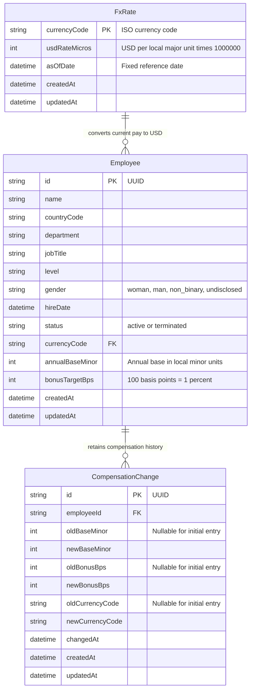

# Database diagram

SQLite model for [the requirements](REQUIREMENTS.md). V1 field semantics and calculation rules are defined in [PRODUCT_RULES.md](PRODUCT_RULES.md). The tables and indexes are implemented in [schema.prisma](../packages/db/prisma/schema.prisma); API workflows are planned in later steps.

- Current compensation lives on Employee. Bonus amounts and USD compensation are derived rather than stored.
- The server validates country/currency mapping and required department/title text and supported level values. Separate management tables are not proposed for v1.
- Updating compensation and appending history happen in one database transaction. An unchanged save adds no history entry; creation adds an initial entry with null previous values.
- History stores old/new currency snapshots alongside amounts so a later currency change cannot relabel past pay. Currency snapshot fields do not reference mutable FX rates.
- Termination changes employee status; employee and history records remain. Insights exclude terminated employees.
- The diagram describes compensation history, not a general audit trail for profile edits. FX precision, rounding, and explicit compensation on currency changes follow PRODUCT_RULES.md.
- Initial indexes cover status/name/ID ordering, country, department, title, level, currency references, and employee/time history retrieval. Measure actual directory queries before adding more.
