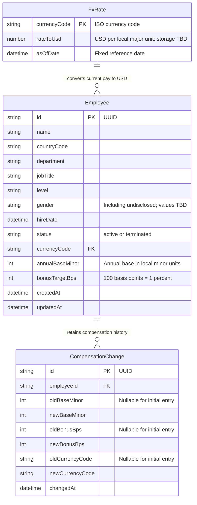

# Database diagram

Proposed SQLite model for [the requirements](REQUIREMENTS.md). Field names and storage choices are design proposals until implemented; open calculation rules are tracked in [the plan](PLAN.md#1-settle-product-and-calculation-rules).

- Current compensation lives on Employee. Bonus amounts and USD compensation are derived rather than stored.
- The server validates country/currency mapping and controlled department, title, and level values. Separate management tables are not proposed for v1.
- Updating compensation and appending history happen in one database transaction. An unchanged save adds no history entry; an initial entry with null previous values is proposed.
- History stores old/new currency snapshots alongside amounts so a later currency change cannot relabel past pay. Currency snapshot fields do not reference mutable FX rates.
- Termination changes employee status; employee and history records remain. Insights exclude terminated employees.
- The diagram describes compensation history, not a general audit trail for profile edits. FX precision, rounding, and currency-change rules must be settled before implementation.
- Indexes should support measured directory queries and history retrieval by employee/time; they are not all shown in this logical diagram.
